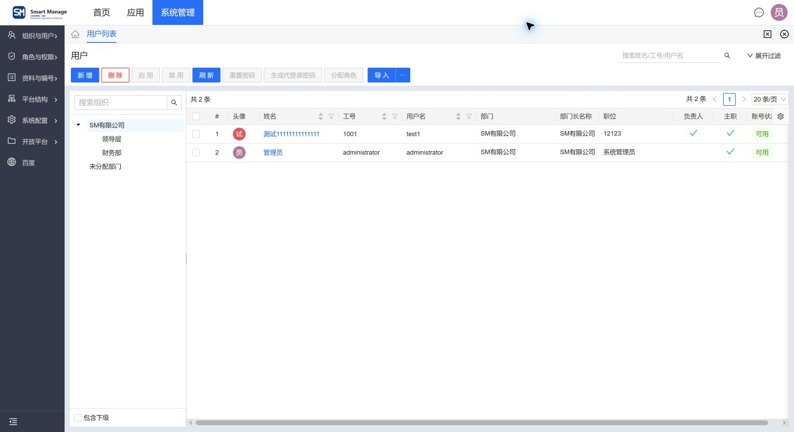
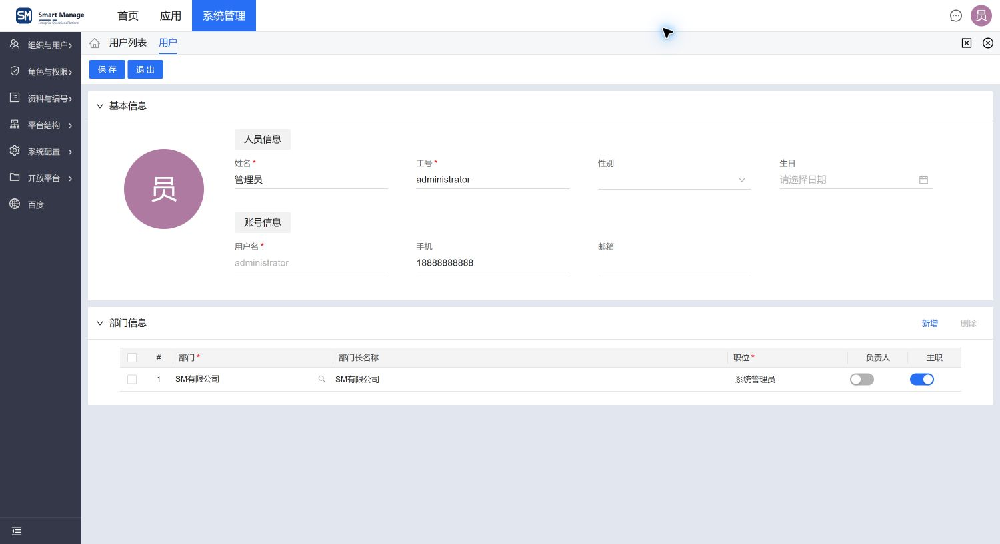
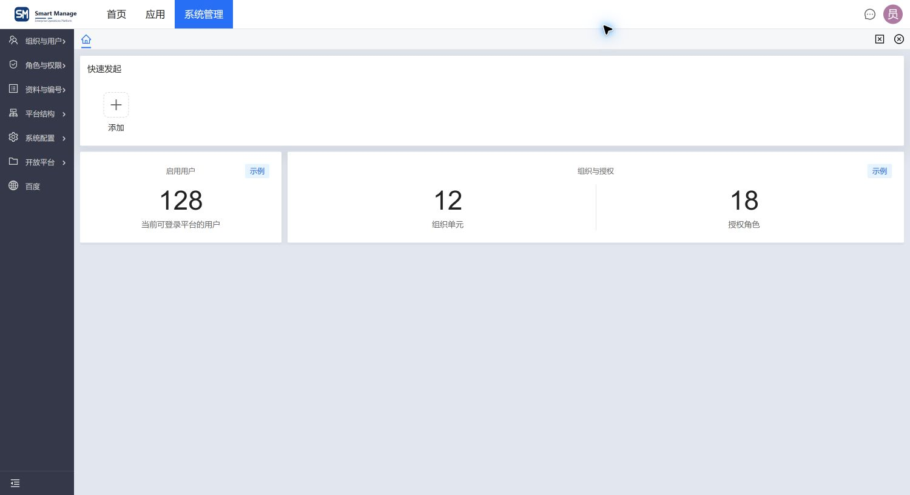

# 项目页面结构示例

[返回规范入口](./README.md)。以下引用仓库已有截图用于阅读结构，不是当前运行实例的全量验收证据；不从旧图反推 API、权限或数据口径。图与规则不一致时核实当前来源。

## 列表

应用与内容页签分层，命令集中，左树选范围、右表显示结果，搜索/过滤与元信息位于各自区域。实际接入见[列表和命令](../development/frontend-page-guide.md#列表和命令)。业务列和图标属于该页面，不要求其它列表照抄。

## 编辑与明细

基本信息与明细分区，普通字段使用共享布局，明细命令位于分区标题右侧；头像属于业务特殊内容。实际接入见[编辑页](../development/frontend-page-guide.md#编辑页)和[明细表格](../development/frontend-page-guide.md#可编辑明细表格)。

## 首页

快捷入口可选，指标卡按轨道比例组合，示例数字显式标记。该图不能证明超量入口滚动；实际行为以[快速发起规则](../platform/base/home-quick-launch.md)与组件为准。

## 示例使用

示例说明底座的通用页面结构，字段、头像、指标与业务数据仅服务各自样例，不能反向成为其它模块的固定要求。新增页面按[模块样板](../development/module-pattern-catalog.md)选择当前真实实现。

| 需求 | 使用方式 |
| --- | --- |
| 增加关键数值列 | 普通文本沿用省略策略；关键值按[完整值要求](./foundations.md#关键金额与数量)调整列宽、布局或区域滚动，不用省略后的提示代替直接完整显示 |
| 增加编辑明细 | 使用公共明细表格与字段能力，业务自行定义字段、单位和校验 |
| 增加实体选择 | 复用实体引用协议与服务端候选范围，避免复制全量资料到本地 Select |
| 增加分析图 | 按[图表规范](./charts.md)表达指标，并提供完整数据访问；参见[交互示例](./chart-examples.md) |
| 增加风险命令 | 按[异步确认与结果反馈](../development/frontend-page-guide.md#异步确认与结果反馈)返回完整命令 Promise，并明确错误与成功提示的唯一所有者 |

上述示例不要求额外新增通用封装；已有能力足够时直接复用公开契约。
